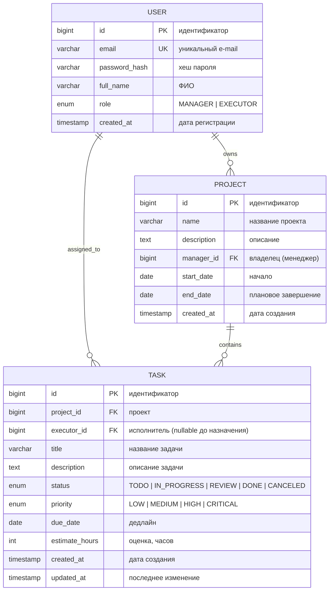
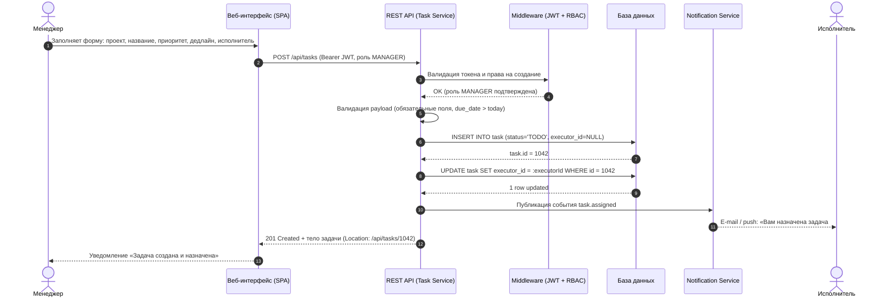

# Team Task Tracker — Системный анализ (analysis_spec.md)

**Версия:** 1.0 · **Дата:** 2026-10-12 · **Автор:** Ведущий системный аналитик

---

## 1. Описание системы

### 1.1. Цели

Веб-приложение **Team Task Tracker** предназначено для планирования, распределения и контроля задач внутри команд проектов.

| # | Цель | Метрика успеха |
|---|------|----------------|
| G1 | Централизовать управление задачами команды в одном веб-интерфейсе | 100% задач проекта ведутся в системе |
| G2 | Обеспечить прозрачность загрузки и статуса работ для менеджера | Обновление статуса задачи — не позднее 24 ч с момента изменения |
| G3 | Сократить время на постановку и приёмку задач | ≤ 5 минут на создание и назначение одной задачи |

### 1.2. Роли пользователей

| Роль | Описание | Основные полномочия |
|------|----------|---------------------|
| **Менеджер (MANAGER)** | Владелец проекта, координатор команды | Создаёт/редактирует проекты и задачи, назначает исполнителей, меняет приоритеты, закрывает спринты, просматривает отчёты |
| **Исполнитель (EXECUTOR)** | Член команды, выполняющий задачи | Просмотр назначенных задач, обновление статуса и прогресса, добавление комментариев, перенос дедлайна (по согласованию) |

Обе роли аутентифицируются через единую учётную запись `User`; роль хранится в атрибуте `role` и проверяется на уровне API (RBAC).

### 1.3. Ключевые функции

1. **F1. Управление проектами и задачами** — создание проекта, создание задачи внутри проекта с указанием названия, описания, приоритета и дедлайна.
2. **F2. Назначение исполнителей** — менеджер назначает задачу одному исполнителю; система фиксирует связь «задача ↔ исполнитель» и отправляет уведомление.
3. **F3. Отслеживание статуса и прогресса** — жизненный цикл задачи (`TODO → IN_PROGRESS → REVIEW → DONE / CANCELED`), история изменений, контрольные сроки и отчётность по загрузке команды.

---

## 2. Модель данных (ER-диаграмма)



**Кардинальность связей:**
- `USER 1 — N PROJECT` — один менеджер владеет многими проектами; проект имеет ровно одного владельца-manager.
- `PROJECT 1 — N TASK` — проект содержит множество задач; задача принадлежит ровно одному проекту.
- `USER 1 — N TASK` — исполнитель принимает множество задач; задача назначена не более чем одному исполнителю (`executor_id` nullable — задача может быть создана без назначения).

---

## 3. Последовательность: «Менеджер создаёт задачу и назначает её Исполнителю»



---

## 4. Фрагмент OpenAPI 3.0 — создание задачи

```yaml
openapi: 3.0.3
info:
  title: Team Task Tracker API
  version: 1.0.0
paths:
  /api/tasks:
    post:
      summary: Создать новую задачу
      description: >
        Создаёт задачу в указанном проекте. Доступно только роли MANAGER.
        Поле executorId опционально: если передано, задача сразу назначается
        исполнителю и публикуется событие task.assigned.
      operationId: createTask
      tags:
        - Tasks
      security:
        - bearerAuth: []
      requestBody:
        required: true
        content:
          application/json:
            schema:
              $ref: '#/components/schemas/CreateTaskRequest'
            example:
              projectId: 7
              title: "Реализовать экспорт отчёта в XLSX"
              description: "Добавить выгрузку сводного отчёта по спринту."
              priority: HIGH
              dueDate: "2026-11-01"
              estimateHours: 16
              executorId: 42
      responses:
        '201':
          description: Задача успешно создана (и при наличии executorId — назначена)
          headers:
            Location:
              description: URL созданного ресурса
              schema:
                type: string
                format: uri
          content:
            application/json:
              schema:
                $ref: '#/components/schemas/Task'
        '400':
          description: Ошибка валидации входных данных
          content:
            application/json:
              schema:
                $ref: '#/components/schemas/ErrorResponse'
        '401':
          description: Токен отсутствует или недействителен
        '403':
          description: Недостаточно прав (требуется роль MANAGER)
        '404':
          description: Проект или исполнитель с указанным ID не найден
components:
  securitySchemes:
    bearerAuth:
      type: http
      scheme: bearer
      bearerFormat: JWT
  schemas:
    CreateTaskRequest:
      type: object
      required: [projectId, title, priority]
      properties:
        projectId:
          type: integer
          format: int64
          description: ID проекта, в котором создаётся задача
        title:
          type: string
          minLength: 3
          maxLength: 140
        description:
          type: string
          maxLength: 2000
        priority:
          type: string
          enum: [LOW, MEDIUM, HIGH, CRITICAL]
        dueDate:
          type: string
          format: date
          description: Дедлайн задачи (должен быть позже текущей даты)
        estimateHours:
          type: integer
          minimum: 1
          maximum: 400
        executorId:
          type: integer
          format: int64
          nullable: true
          description: ID пользователя-исполнителя (роль EXECUTOR); null — без назначения
    Task:
      type: object
      properties:
        id:
          type: integer
          format: int64
        projectId:
          type: integer
          format: int64
        executorId:
          type: integer
          format: int64
          nullable: true
        title:
          type: string
        description:
          type: string
        status:
          type: string
          enum: [TODO, IN_PROGRESS, REVIEW, DONE, CANCELED]
        priority:
          type: string
          enum: [LOW, MEDIUM, HIGH, CRITICAL]
        dueDate:
          type: string
          format: date
        estimateHours:
          type: integer
        createdAt:
          type: string
          format: date-time
        updatedAt:
          type: string
          format: date-time
    ErrorResponse:
      type: object
      properties:
        code:
          type: string
          example: VALIDATION_ERROR
        message:
          type: string
        details:
          type: array
          items:
            type: object
            properties:
              field:
                type: string
              issue:
                type: string
```

---

## 5. Примечания и допущения

- Аутентификация — JWT (Bearer); авторизация — RBAC по атрибуту `USER.role`.
- Событие `task.assigned` доставляется асинхронно (очередь сообщений), чтобы не блокировать HTTP-ответ.
- Следующие шаги спецификации: диаграмма состояний Task, API обновления статуса, требования к нефункциональным характеристикам (SLA, нагрузочные тесты).
